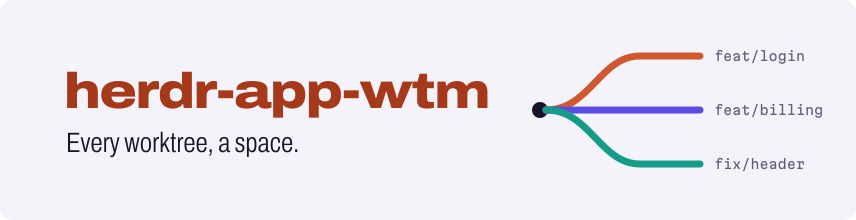
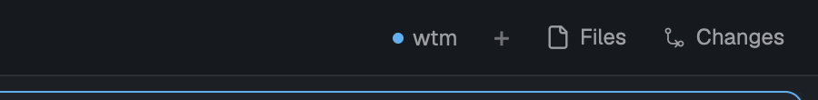

<p align="center">
  <picture>
    <source media="(prefers-color-scheme: dark)" srcset="docs/assets/banner-dark.svg">
    
  </picture>
</p>

<p align="center">A <a href="https://herdr.dev">Herdr app</a> mod for <a href="https://github.com/LucasPcq/wtm">wtm</a>: each worktree you create opens as a space, each one you remove closes its space, whoever ran the command.</p>

<p align="center">
  <a href="https://github.com/LucasPcq/herdr-app-wtm/releases/latest"></a>
  <a href="https://github.com/LucasPcq/herdr-app-wtm/actions/workflows/ci.yml"></a>
  <a href="LICENSE"></a>
</p>

<p align="center">
  <a href="docs/guide/installation.md">Install</a> · <a href="docs/guide/README.md">Guide</a> · <a href="CHANGELOG.md">Changelog</a>
</p>

<p align="center">
  <br>
  <em>One button in the top bar; the sidebar follows your worktrees.</em>
</p>

## Highlights

- **`wtm create` opens a space**, whoever ran it.
- **Your focus stays put.**
- **`wtm clean` and `wtm prune` close the space.**
- **Never closes the main checkout's space.**
- **Only repositories you have open.**
- **One button in the top bar** shows whether sync runs.

## Install

Ask your Herdr agent: *"add the mod at github.com/LucasPcq/herdr-app-wtm"*. It reads [RECIPE.md](RECIPE.md) and every file, copies `mods/wtm/` into `~/.config/herdr-app/mods/`, checks it and opens it once.

Or by hand:

```sh
git clone https://github.com/LucasPcq/herdr-app-wtm
cp -R herdr-app-wtm/mods/wtm ~/.config/herdr-app/mods/
herdr-app check ~/.config/herdr-app/mods/wtm
herdr-app do mod.open '{"name":"wtm"}'
```

Needs the Herdr app and wtm 0.29 or later. The last line, once, shows the button; Herdr reopens it on every start. Updating, removing, and what the mod runs: [Installation](docs/guide/installation.md). Herdr TUI user? Use [herdr-wtm](https://github.com/LucasPcq/herdr-wtm).

## Learn more

[How it works](docs/guide/how-it-works.md) · [Customizing](docs/guide/customizing.md) · [Troubleshooting](docs/guide/troubleshooting.md) · [Changelog](CHANGELOG.md) · [Contributing](CLAUDE.md)

MIT licensed.
