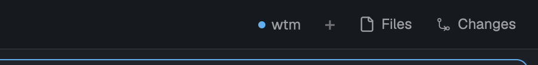

# wtm

Spaces follow [wtm](https://github.com/LucasPcq/wtm) worktrees: a worktree created with `wtm create` opens as a space, one removed with `wtm clean` or `wtm prune` closes its space, whoever ran the command — and the focus never moves. A small floating pill says whether sync runs.

## What you see

- One window, drawn by the mod with `frame: "none"`, opened in the top bar just left of the `+` button (8 px from the top, its right edge 190 px from the window's): a button like Files and Changes — 52 × 26 px, 8 px side padding, radius 6, no border, background `chrome` (`hover` on hover, text then `foreground`), text `muted` at 12 px.
- In it, a 6 px round dot and `wtm`: `accent` dot while syncing, `muted` while starting, `blocked` when sync is down (wtm not found, too old, stream stopped, error); the notification says which.
- Spaces appear in and leave the regular spaces sidebar; the mod draws nothing else.

## How it behaves

- `worktree.created` in a repository the window shows (a local space's first terminal, or its folder, is in that repository): a space opens on the worktree, then the previously active space is selected again. Nothing happens for the main checkout, a folder already gone, or when a space is already inside the worktree.
- `worktree.removed`: every local space whose first terminal (or folder) is inside the worktree closes, if the folder is gone and it is not the main checkout.
- Double-clicking the pill while the dot is `accent` (or `herdr-app do wtm.sync`) syncs what is already there: every local space whose folder and first terminal's folder are both gone closes, then the worker restarts and each `snapshot` line, until `ready`, is replayed as a `worktree.created` per worktree. Snapshots are ignored otherwise.
- Entering a blocked state posts one error notification with the cause and the fix. Clicking the pill then retries; otherwise presses drag it.
- `herdr-app do wtm.stop` removes the worker and closes the pill.
- Agent statuses play no part.

## Built from

- `mods/wtm/` only; no layout. `mod.json`: `{ "place": "none", "title": "wtm" }`.
- Launcher copy (shown by `mod.open`, no `props().service`): `mod.json`'s `"overlay": { "kind": "dialog", "width": 0.5, "height": 0.5, "frame": "none" }` makes it half the window; its root's `on_size_change` (ignoring a first report with an empty side) gives the window's size ×2; then `openOverlay({ mod: "wtm", kind: "window", key: "wtm", keep: true, frame: "none", at, props: { service: true } })` with `at` from `style.js`'s `position`, and `closeOverlay(props().overlay)`. Unmeasured after 1 s, it opens without `at`.
- Service copy (the kept window): `exec("which", ["wtm"])`, `wtm version --output json` (`events >= 1`), `mkdir -p ~/.local/state/herdr-app-wtm/inbox`, then `hc run --bg --name herdr-app-wtm --outlive-parent --label herdr-app-wtm.script=1 -- sh -c <script> sh <inbox> <wtm>`, reused while live with that label.
- The script runs `cd / && wtm events --output json` and writes every non-empty line to `.tmp` then `mv` to `<n>.json` (`n` = seconds × 10⁶ + counter), then `{"type":"herdr-app-wtm.exit","code":N}`.
- The mod `watchFolder`s the inbox (plus a 30 s fallback), claims each `<n>.json` by renaming it to `<n>.json.<copyId>.<ms>` (`mv`), reads it, acts, removes it. Claims older than a minute are released on start.
- `spaces()`, `panes()`, `focused()`, `run("space.new" | "space.select" | "space.close")`, `notify`, `nextCommand` (`stop`, `sync`), `exec` for `git rev-parse --path-format=absolute --git-common-dir`, `test -e`, `mv`, `rm`.
- Exit codes 2 and 20 stop for good; others restart with 1 s → 30 s backoff, reset on `ready`.

## Watch out

- **After copying `mods/wtm/`, open it once:** `herdr-app do mod.open '{"name":"wtm"}'`. Without it nothing syncs; with it, Herdr reopens the button on every start. It needs no `keys.json` and no layout.
- A mod only runs while shown, and Herdr's shipped layouts are read-only: `place` other than `none` never docks there. The kept window is what keeps the mod alive.
- `exec` does not stream; `watchFolder` sees created and renamed entries but not appends, and seems to skip hidden folders: hence one file per event in a non-hidden folder.
- `fs` writes only under `~/.config/herdr-app` and reads only inside home: use `exec` for the inbox's writes and for `test -e` on worktree paths.
- `space.new` selects the new space: select the previous one right after.
- Windows are placed by absolute `at` only, and a mod cannot read the window's size: measure it with a share-sized dialog. A popup ignores its height share (sized by content), `1` reads as one pixel, and Herdr keeps windows off the bottom edge, so a pill aimed at the status bar lands above it.
- Two copies can run (two layouts, two clients): the rename-claim makes each event handled once.

## Done when

- `make check` and `make test` pass.
- `herdr-app do mod.open '{"name":"wtm"}'` shows the button with an `accent` dot just left of `+`, and `hc get herdr-app-wtm` is live.
- `wtm create x --yes` in a shell, in a repository the window shows, opens a space named `x` while `herdr-app status` keeps the same `space`.
- `wtm clean x --yes` closes it.
- With the worker killed (`hc kill herdr-app-wtm`), `wtm create y --yes` opens nothing; `herdr-app do wtm.sync` opens `y`, focus unchanged. Killed again, `wtm clean y --yes` then `herdr-app do wtm.sync` closes it.
- Quitting and reopening the app brings the pill back, and syncing continues.
- `herdr-app do wtm.stop` removes the pill and the `herdr-app-wtm` terminal.
